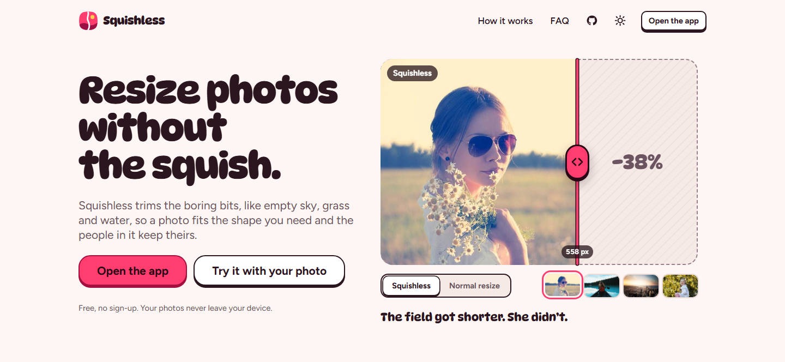
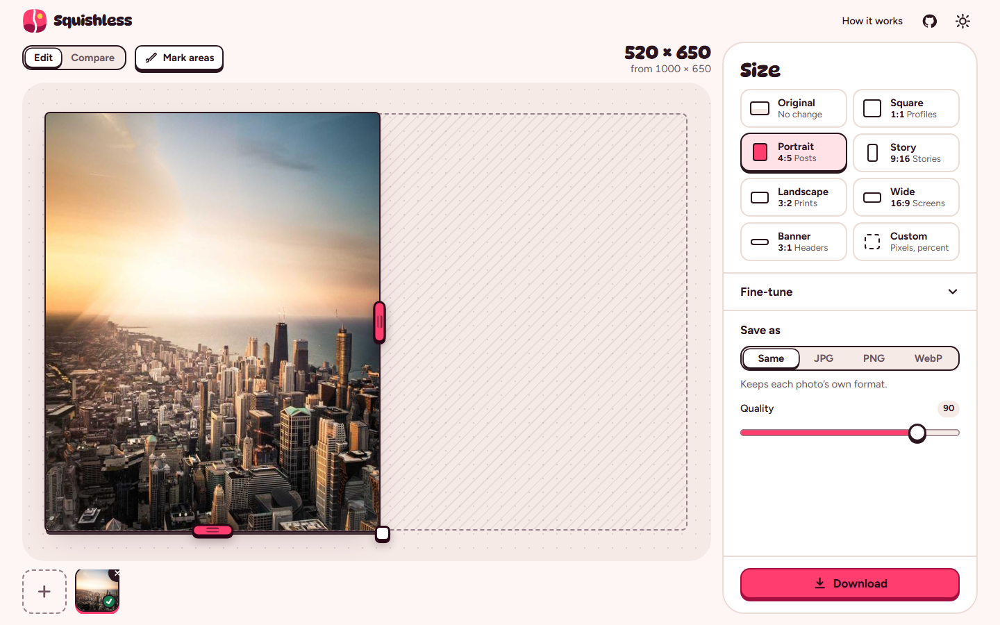
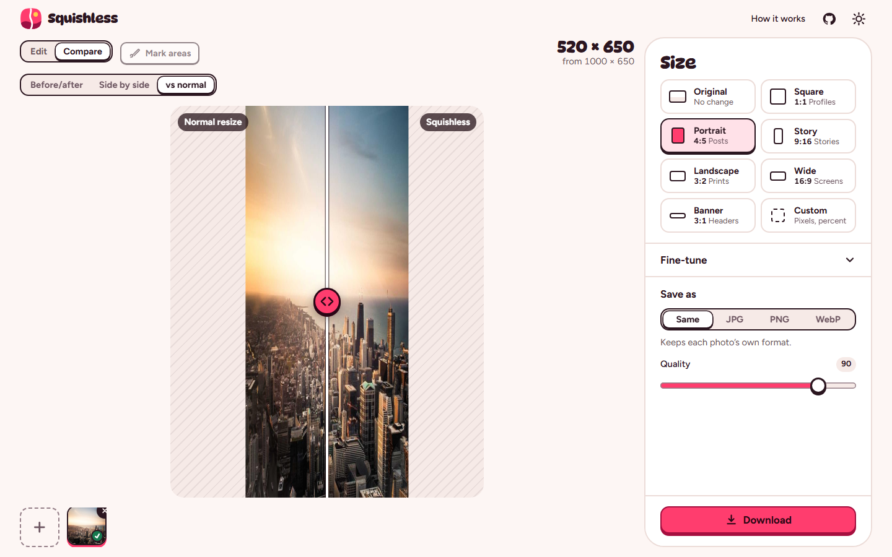
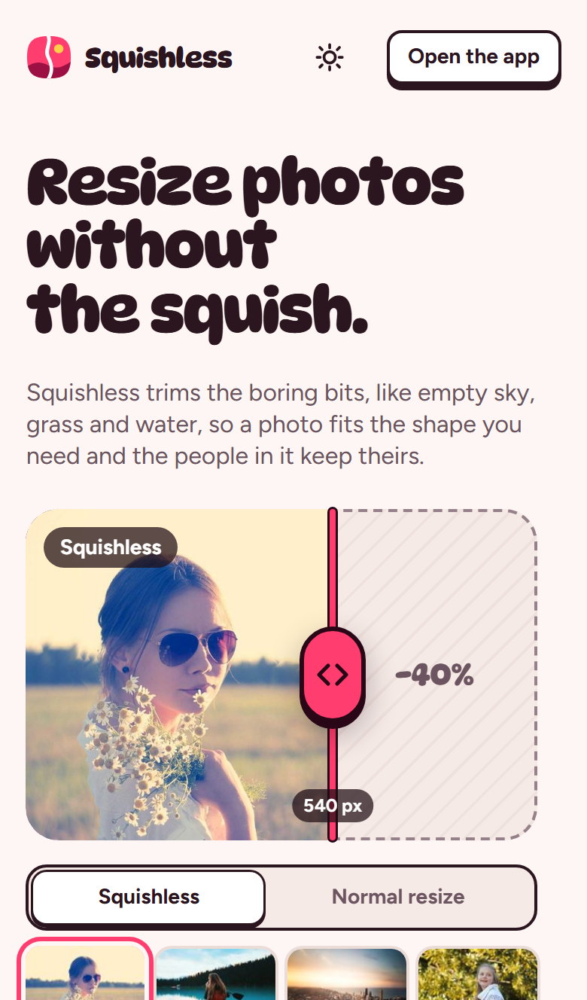
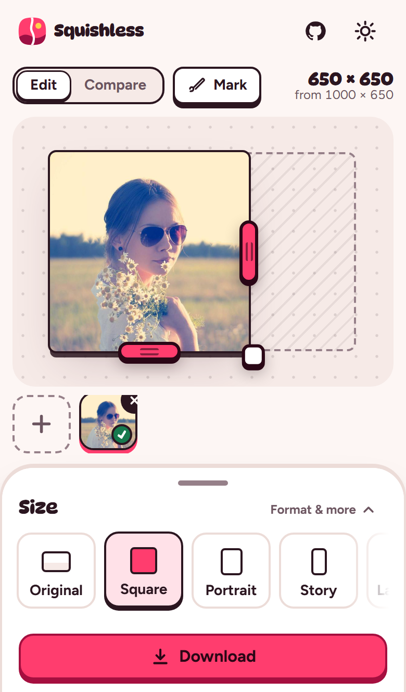

<div align="center">


# Squishless

**Resize photos without the squish.**

A free web app that changes a photo's size or shape with *seam carving*. It trims the
boring bits, like empty sky, grass and water, so the people and things in the photo keep
their shape. Everything runs in your browser, and nothing is uploaded.

<!-- LIVE_URL: replace https://squishless.vercel.app below (two places in this file) with the real address once it is deployed -->
**[Open Squishless &rarr;](https://squishless.vercel.app)**

</div>



| Editing in the app | "vs normal resize" compare |
| --- | --- |
|  |  |

## Use it

<!-- LIVE_URL -->
Go to **https://squishless.vercel.app**, pick a photo (or try one of the samples) and
drag an edge. There is nothing to install and no account to make. After the first visit
it also works offline, and you can install it as an app from your browser's menu.

## Features

- **Live drag-to-resize.** Pull the right or bottom edge of the photo and the preview
  follows your finger. The full-quality result arrives a moment after you let go.
- **Size presets by purpose:** Square 1:1, Portrait 4:5, Story 9:16, Landscape 3:2,
  Wide 16:9, Banner 3:1, or Custom (exact pixels or percent).
- **Compare:** a before/after slider, side by side, and **"vs normal resize"**, which shows
  what a plain stretch or squash would have done to the same photo.
- **Keep / Remove brush.** Paint over what must stay, or over what should go first (a stray
  lamp post, a photobomber).
- **Face protection.** Faces are found automatically and left alone.
- **Batch.** Load a stack of photos, resize them all, and download one ZIP.
- **Save as** JPG, PNG or WebP (or the photo's own format), with a quality setting.
  On phones you can also share or save straight to your photos.
- **Big photos are handled kindly.** If a photo is too big for your device, the app offers
  to shrink it a little first instead of failing.
- **Fine-tune** (optional): face protection on/off, blur radius and edge threshold.
- Camera rotation (EXIF) is respected, and location and other metadata are not copied into
  the result.
- Light and dark themes, keyboard friendly, works on phones, tablets and desktops.

<p align="center">
  
  &nbsp;&nbsp;
  
</p>

## Privacy

**Squishless runs entirely in your browser. Nothing is uploaded.**

- The resizing engine is downloaded once and runs on your own device. There is no server
  that receives photos; there isn't one to send them to.
- No cookies, no analytics, no trackers, no accounts.
- No third-party requests: fonts and every other file come from the site itself. A strict
  Content Security Policy blocks connections to other sites.
- The only things stored in your browser are your settings (such as theme and format),
  the site's own files for offline use, and, just while the app opens, a photo you dropped
  on the landing page. Nothing is stored anywhere else.

You can check this yourself: open the browser's developer tools on the Network tab while
you use the app, or load the app and then turn off your Wi-Fi.

## How it works

Seam carving was introduced by Shai Avidan and Ariel Shamir in 2007. First, every pixel
gets an "energy" score: pixels on edges and details score high, while flat areas like sky
score low. A *seam* is a connected line of pixels from the top of the photo to the bottom
(or from left to right), and the algorithm finds the seam with the lowest total energy,
the "most boring path". Removing that seam makes the photo one pixel narrower without
touching the interesting parts, and repeating this hundreds of times gets it to the size
you want. To make a photo wider, it duplicates low-energy seams instead.

In Squishless:

- The engine is written in **Go** and compiled to **WebAssembly**, so the same code that
  was tested natively runs in the browser.
- It runs in **Web Workers** (2 or 3 at a time), so the page stays smooth while photos are
  being carved, and a resize can be cancelled at any time.
- The **live preview** while you drag uses a *seam-order map*: the engine works out, once,
  in which order every pixel would be removed. After that, any width or height is just a
  matter of hiding the pixels removed by then, which takes about 1.5 ms per frame. When you
  let go, the exact result is computed.
- The landing page demo uses **precomputed seams** that are made at build time, so it is
  interactive before the engine has even loaded.

[docs/architecture.md](docs/architecture.md) explains how the parts fit together.

## Run it locally

You need:

- **Go** (latest stable; `go.mod` sets the minimum),
- **Node.js** 22 or newer,
- **bash** (on Windows, Git Bash works).

```sh
npm run build     # builds dist/: the static site plus the WebAssembly engine
npm run serve     # http://127.0.0.1:8787, with the same headers as production
```

Or do both in one go: `npm run build && npm run serve`.

`scripts/serve.mjs` accepts `--port` (or the `PORT` environment variable), `--dir`
(default `dist`) and `--quiet`. There are no runtime npm dependencies and no bundler:
the site is plain HTML, CSS and ES modules, and `npm ci` is only needed for the tests.

## Tests

```sh
go vet ./...
go test ./...                       # engine and build-time tools
npm run build
node scripts/wasm-smoke.mjs         # loads the built .wasm in Node and checks it

npm ci
npx playwright install              # once: Chromium, Firefox and WebKit
npx playwright test                 # builds, serves and tests in all 5 browser setups
npx playwright test --project=chromium
```

Playwright runs desktop Chrome, Firefox and Safari (WebKit), plus Pixel 7 and iPhone 14
emulation. Set `E2E_NO_BUILD=1` to test the existing `dist/` without rebuilding, and
`PORT` to use another port. The same checks run on GitHub Actions for every push
(`.github/workflows/ci.yml`).

## Deploy to Vercel

It is a static site, so the free Hobby plan is enough. In short:

1. Push the repo to GitHub.
2. In Vercel, choose **Add New... > Project**, import the repo and click **Deploy**.
   Leave the build settings alone: `vercel.json` already sets them.

Or use the CLI from the repo folder: `vercel` for a preview, `vercel --prod` for production.

Vercel's build image has no Go, so `scripts/build-site.sh` downloads a pinned Go release
(checksum verified) when it can't find one. You don't need to set anything up.

What `vercel.json` does:

| Setting | Why |
| --- | --- |
| `buildCommand: bash scripts/build-site.sh` | Builds the wasm engine and copies the site to `dist/` |
| `outputDirectory: dist` | What gets published |
| `installCommand: echo skip-install` | The site has no npm dependencies, so there is nothing to install |
| `framework: null`, `cleanUrls`, `trailingSlash: false` | Plain static hosting; `/app` serves `app/index.html` |
| Security headers | Content Security Policy, `X-Frame-Options`, `Referrer-Policy`, `Permissions-Policy` and more |
| Cache headers | Pages always revalidate; the engine, fonts and seam files are cached for a year (their URLs change with every build) |
| `Content-Type: application/wasm` | Lets browsers compile the engine while it downloads |

[docs/deploying.md](docs/deploying.md) has the full step-by-step guide, including a custom
domain.

## Project layout

```
engine/              Go seam-carving engine (energy, seams, face protection, masks)
cmd/wasm/            WebAssembly entry point plus the JS glue for it
cmd/heroseams/       build-time tool: precomputes the landing demo's seams and gallery
site/                the static site, served as-is (no bundler)
  index.html         landing page
  app/index.html     the app
  styleguide.html    the design system: tokens and components
  assets/css/        tokens.css, base.css, landing.css, app.css
  assets/js/         ES modules: engine.js, worker.js, livepreview.js, compare.js, app/, landing/
  assets/fonts/      self-hosted fonts and their licences
  samples/           sample photos and CREDITS.txt
  sw.js              service worker (offline support)
scripts/             build-site.sh, postbuild.mjs, serve.mjs, wasm-smoke.mjs
tests/e2e/           Playwright tests
docs/                these docs and the screenshots
vercel.json          Vercel build settings and headers
dist/                build output (not committed)
```

## Browser support and limits

- Works in current **Chrome, Edge, Firefox and Safari**, on desktop, iOS and Android.
  It needs WebAssembly and Web Workers, which every current browser has.
- **Photo size limit: 24 megapixels on desktop, 12 megapixels on phones.** Bigger photos
  get a one-click offer to shrink them to the limit first.
- **Speed.** Seam carving looks at every pixel again for every seam it removes, so time
  grows with both the photo size and how much you change it. Rough numbers in Chrome on a
  laptop:
  - a 1000 × 650 photo made 350 px narrower: about 0.5 to 2 seconds;
  - a 20-megapixel camera photo cropped to 16:9: about 40 seconds;
  - phones are slower, and a 12-megapixel phone photo can take 20 to 40 seconds.

  A progress bar and a Cancel button are always there.
- **Memory.** Carving uses roughly 30 to 40 bytes per pixel, so the app limits how many
  big photos it works on at once. A very large batch on an older phone may still run out
  of memory; if so, the app says so and you can try a smaller size.
- Formats you can open: anything your browser can decode (JPEG, PNG, WebP, GIF, BMP, AVIF;
  HEIC on Safari). Formats you can save: JPG, PNG, WebP (PNG where the browser can't make
  WebP).

## Credits

- **Seam carving:** Shai Avidan and Ariel Shamir, *Seam Carving for Content-Aware Image
  Resizing*, ACM SIGGRAPH 2007.
- **Squishless is based on [esimov/caire](https://github.com/esimov/caire)** by Endre Simo
  (MIT licence). The engine follows caire's approach to content-aware resizing (Sobel
  energy, face protection with pigo, keep/remove masks) and was adapted for speed and for
  the web (seam-order maps, raw RGBA input, WebAssembly). Thank you, Endre.
- **Face detection:** [esimov/pigo](https://github.com/esimov/pigo) by Endre Simo (MIT
  licence), including its face-finder cascade file (`engine/facefinder`).
- **Fonts:** [DynaPuff](https://github.com/googlefonts/dynapuff) (Copyright 2021 The
  DynaPuff Project Authors) and [Figtree](https://github.com/erikdkennedy/figtree)
  (Copyright 2022 The Figtree Project Authors), both under the SIL Open Font License 1.1.
  The licence texts are in [site/assets/fonts/](site/assets/fonts/).
- **Sample photos** (full list in [site/samples/CREDITS.txt](site/samples/CREDITS.txt)):
  - `lake-canoe.jpg`: Roberto Nickson on Unsplash
  - `portrait-field.jpg`: Alexander Shustov on Unsplash
  - `city-skyline.jpg`: Kevin Young on Unsplash
  - `sample.jpg`: from the esimov/caire repository (MIT licence)

  Unsplash photos are used under the [Unsplash License](https://unsplash.com/license).

## Licence

<!-- TODO (owner): choose a licence for the Squishless code, add a LICENSE file and update this section. -->
**The licence for Squishless's own code has not been chosen yet.** Until a `LICENSE`
file is added, please ask before reusing the code.

Third-party parts keep their own licences: caire and pigo (MIT), DynaPuff and Figtree
(SIL Open Font License 1.1), and the sample photos (Unsplash License, or MIT for the caire
sample). Any licence chosen for Squishless must keep their copyright notices.

## Contributing

Bug reports and ideas are welcome in
[GitHub issues](https://github.com/HaiderAli3D/squishless-web/issues). See
[CONTRIBUTING.md](CONTRIBUTING.md) before opening a pull request.
